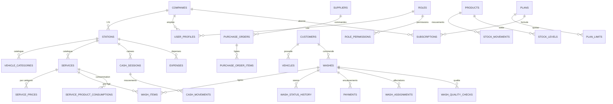

# LAVAUTO — Base de données & architecture du domaine (Prompts 03–09)

> Le journal ci-dessous décrit les phases précédentes. `051_station_logo.sql` et `052_atomic_wash_creation.sql` ont été appliquées sur `lavauto` via le connecteur, sous `20261112130423_station_logo` et `20261112130520_atomic_wash_creation` ; leurs contenus correspondent aux fichiers locaux. `051` ajoute le chemin privé du logo ; `052` ajoute la création atomique et la distinction des canaux mobiles. Le dépôt contient maintenant **54 migrations locales numérotées**, sans `048` : `053` (WhatsApp), `054` (périmètre station et métriques) et `055` (validation et finance) n’ont pas été appliquées à distance. Voir [whatsapp-receipts.md](whatsapp-receipts.md) et [testing.md](testing.md).

**Date :** 12/11/2026 · **Projet Supabase :** `lavauto` (`cgxrqorwmmcyqescatzs`, `eu-central-1`, PostgreSQL 17.11) · **Branche historique P10 :** `arena/868cde36-lavauto` · **Statut historique :** schéma P03, Auth / RBAC P04, cœur lavages P05, finance P06, stock P07, CRM P08, analytics / administration SaaS P09 et QA / déploiement P10 appliqués.

> Les sections de phases décrivent le schéma historique réellement appliqué à leur date ; les vérifications de `051` et `052` sont documentées séparément dans [testing.md](testing.md). Le projet `BarberShop` (`fpapxbfsiiwgpvsefsec`) n'a pas été consulté en écriture ni modifié. Aucune clé `service_role`, aucun secret et aucune donnée métier de démonstration n'ont été introduits.

---

## 1. Périmètre et principes

Le Prompt 03 pose les fondations persistantes de l'ERP SaaS multi-entreprises, **sans réécrire le frontend validé** :

| Principe | Mise en œuvre |
| --- | --- |
| Multi-entreprises | `companies` → `stations` en **1:N** ; 43 tables portent un `company_id` imposé par le serveur (dont `roles`, où il est nullable pour les rôles systèmes). |
| Identité d'entreprise non falsifiable | `current_company_id()` lit `user_profiles` à partir de `auth.uid()` ; `enforce_company_id()` rejette toute valeur différente sur `INSERT/UPDATE`. Aucun `company_id` n'est accepté depuis le navigateur. |
| Isolation | **RLS activée sur les 69 tables** ; 70 politiques après le Prompt 04, puis politiques additives P05–P08 ; `can_access_station()` pour le périmètre station ; `is_platform_admin()` séparé du tenant. |
| Intégrité | 154 clés étrangères, 68 contraintes `CHECK`, 19 contraintes d'unicité, 99 index, UUID, `timestamptz`, `deleted_at`, `updated_at` par trigger. |
| Montants | Entiers `*_minor` en unité mineure de la devise. `XOF` (FCFA, 0 décimale) est la devise initiale ; `currencies` prépare XAF, GHS, NGN, KES. |
| Historique | Prix figé dans `wash_items`, statuts dans `wash_status_history`, paiements, mouvements de caisse et de stock **append-only** ; `REVOKE UPDATE/DELETE` + triggers d'immuabilité. |
| Transactions | 8 fonctions métier `SECURITY DEFINER` contrôlent permission, état, périmètre, idempotence et cohérence dans une seule transaction ; 11 fonctions Auth/RBAC supplémentaires ajoutées au Prompt 04. |
| Versionnement | 49 migrations historiques P03–P10 ont été suivies par `051` et `052` sur `lavauto`, soit 51 entrées distantes. Le fichier `048` a été retiré sans jamais être appliqué. Les versions distantes horodatées diffèrent des noms locaux : ne pas les rejouer. |
| Réversibilité | `VITE_DATA_SOURCE=local` restaure immédiatement le comportement frontend précédent ; les migrations restent en place. |

### Ce qui n'est **pas** dans le Prompt 03

Le Prompt 04 a ensuite branché Supabase Auth, les invitations, les permissions serveur et les triggers d'audit : voir [docs/auth-rbac.md](auth-rbac.md). Le Prompt 05 a branché le cycle lavages sur des RPC `SECURITY DEFINER` (migrations `021`/`022`/`023`, écritures directes révoquées) : voir [docs/washes.md](washes.md). Le Prompt 06 a branché caisse, paiements, dépenses, rapprochements par canal, commissions figées et rapport `my_profitability()` : voir [finance.md](finance.md). Le Prompt 07 a ajouté les coûts de stock et la certification du résultat net ; voir [stock.md](stock.md). Le Prompt 08 a ajouté fiches enrichies, fidélité, forfaits, promotions, flottes et une file de notifications sans fournisseur ; voir [crm.md](crm.md). P09 a livré les vues analytiques, les quotas serveur et le back-office administrable ; voir [analytics.md](analytics.md). P10 a ensuite ajouté CI/CD, Storage, E2E navigateur et optimisation.

---

## 2. Migrations appliquées

Le relevé historique `list_migrations` sur `cgxrqorwmmcyqescatzs` indiquait notamment :

| Version | Nom | Contenu |
| --- | --- | --- |
| `20261111183552` | `001_extensions_and_companies` | `pgcrypto`, `currencies`, `companies`, `stations` (1:N, devise, locale, horaires, activation). |
| `20261111183615` | `002_identity_rbac` | `roles`, `permissions`, `role_permissions`, `user_profiles`, `user_station_assignments`, `user_invitations`, `platform_admins`, `audit_logs` + helpers de sécurité. |
| `20261111183658` | `003_catalog` | Catégories de véhicules, prestations, `service_prices`, historique des tarifs, postes, moyens de paiement, catégories de dépenses. |
| `20261111183714` | `004_washes` | Clients, véhicules, `washes` (7 statuts), `wash_items` (prix figé), historique de statut, affectations, contrôle qualité. |
| `20261111183731` | `005_finance` | Caisses, mouvements, paiements, annulations, dépenses, créances, rapprochement par canal. |
| `20261111183742` | `006_hr_commissions` | Contrats, périodes, lignes de commission, paiements de commission. |
| `20261111183759` | `007_stock_purchasing` | Fournisseurs, produits, commandes, mouvements immuables, niveaux, inventaires, consommations théoriques par prestation. |
| `20261111183814` | `008_saas` | `plans`, `plan_limits`, abonnements, changements, usage, journal plateforme + 3 formules administrables. |
| `20261111183828` | `009_rls` | RLS sur **toutes** les tables, 65 politiques, politiques explicites pour les tables de référence, `REVOKE` sur les historiques. |
| `20261111183933` | `010_functions_triggers` | 82 triggers initiaux, 8 fonctions métier transactionnelles, grants d'exécution. |
| `20261111191502` | `011_auth_bootstrap` | Trigger `AFTER INSERT ON auth.users`, `my_context()`, invitations, permissions Auth/RBAC. |
| `20261111191526` | `012_rbac_policies` | Politiques RLS explicites sur profils, affectations et invitations (`has_permission`). |
| `20261111191554` | `013_audit_triggers` | 3 triggers d'audit d'identité, acteur `auth.uid()`. |
| `20261111191624` | `014_user_admin_functions` | `admin_update_user()` et `revoke_invitation()` contrôlées côté serveur. |
| `20261111191819` | `015_company_read_views` | `my_company_users()` et `my_company_invitations()`. |
| `20261111192521` | `016_owner_guard` | Abonnement réservé au propriétaire ; propriétaire protégé. |
| `20261111193351` | `017_granular_user_permissions` | Permissions granulaires vérifiées dans `admin_update_user()`. |
| `20261111193836` | `018_platform_admin_reads` | Super admin hors tenant : lecture de tous les profils / invitations. |
| `20261111195327` | `019_platform_admin_profile` | Exception contrôlée à `enforce_company_id()` pour le profil super admin sans tenant. |
| `20261111195422` | `020_platform_admin_audit` | Journal d'audit du super admin hors tenant, acteur `auth.uid()`. |

Les migrations additives `021`–`038` sont appliquées après ce journal : `021`–`023` cycle lavages, `024`–`029` finance, `030`–`033` stock/certification, puis P08 :

| Version | Nom | Contenu |
| --- | --- | --- |
| `034` | `crm_foundation` | 12 permissions, 30 liaisons, 13 tables CRM, extensions de `customers` / `vehicles` / `washes`, RLS et `REVOKE`. |
| `035` | `crm_commands` | `assert_crm_station()` et 15 RPC `SECURITY DEFINER`. |
| `036` | `crm_board` | `my_crm_board()` : 15 collections, `stats`, `rules`, aucun `company_id`. |
| `037` | `crm_notifications` | `enqueue_notification()` / `cancel_pending_notification()`, aucun fournisseur. |
| `038` | `promotion_idempotency_order` | Correctif : idempotence vérifiée avant quota et clé dérivée par défaut. |

**Incident résolu :** la première soumission de `003_catalog` utilisait `UNIQUE (station_id, lower(name))`, invalide en PostgreSQL (`42601`). Le fichier local et la migration réappliquée utilisent désormais `CREATE UNIQUE INDEX uq_expense_categories_name ON public.expense_categories (station_id, lower(name));`. Une migration de test `unused_probe` a été créée puis retirée du journal `supabase_migrations.schema_migrations` ; les 20 versions ci-dessus sont les seules présentes. Détail Auth/RBAC : [docs/auth-rbac.md](auth-rbac.md).

---

## 3. Modèle conceptuel



### Inventaire des 69 tables

| Domaine | Tables |
| --- | --- |
| Fondations | `currencies`, `companies`, `stations` |
| Identité / RBAC / audit | `roles`, `permissions`, `role_permissions`, `user_profiles`, `user_station_assignments`, `user_invitations`, `platform_admins`, `audit_logs`, `platform_audit_logs` |
| Catalogue | `vehicle_categories`, `services`, `service_prices`, `service_price_history`, `wash_posts`, `payment_methods`, `expense_categories` |
| Exploitation | `customers`, `vehicles`, `washes`, `wash_items`, `wash_status_history`, `wash_assignments`, `wash_quality_checks` |
| Finance | `cash_sessions`, `cash_movements`, `payments`, `payment_cancellations`, `expenses`, `receivables`, `channel_reconciliations` |
| RH / commissions | `employee_contracts`, `commission_periods`, `employee_commissions`, `commission_payouts` |
| Stock / achats | `suppliers`, `products`, `purchase_orders`, `purchase_order_items`, `stock_movements`, `stock_levels`, `inventory_sessions`, `inventory_items`, `service_product_consumptions` |
| SaaS | `plans`, `plan_limits`, `subscriptions`, `subscription_changes`, `subscription_usage` |
| CRM / fidélité / forfaits / flottes (P08) | `loyalty_programs`, `loyalty_cards`, `loyalty_transactions`, `package_plans`, `customer_packages`, `package_usages`, `promotions`, `promotion_usages`, `fleets`, `fleet_contracts`, `fleet_vehicles`, `fleet_receivables`, `notification_outbox` |

### Statuts et règles figées

- `washes.status` : `pending`, `assigned`, `in_progress`, `quality_check`, `ready`, `delivered`, `cancelled` (7 statuts, appliqués au Prompt 05 avec garde d'état serveur).
- `wash_items.unit_price_minor` et `service_name` sont **copiés au moment de la création** : modifier `service_prices` ne change jamais une fiche existante.
- `service_price_history`, `wash_items`, `wash_status_history`, `cash_movements`, `payments`, `payment_cancellations`, `stock_movements`, `commission_payouts`, `audit_logs`, `platform_audit_logs` : 10 triggers `trg_*_immutable` interdisent `UPDATE/DELETE`.
- `cash_sessions` : clôture non modifiable silencieusement, réouverture motivée et permission `cash.reopen` ; **aucun mouvement à zéro** n'est créé.
- `commission_periods` validées/payées : figées ; les lignes ne sont plus modifiables ni supprimables.
- `purchase_orders` : seule la **réception** écrit un mouvement `purchase_receipt` et incrédite `stock_levels`. La création de commande n'augmente pas le stock.
- `consume_products_for_wash` : consommation théorique une seule fois par `(fiche, produit)`, jamais de stock négatif.
- `channel_reconciliations.difference_minor` et `inventory_items.difference` sont des colonnes générées, pas des valeurs saisies.

---

## 4. Sécurité multi-entreprises

### Helpers (`002_identity_rbac`)

| Fonction | Rôle |
| --- | --- |
| `current_company_id()` | `SECURITY DEFINER`, `search_path` figé : renvoie le tenant de `auth.uid()` depuis `user_profiles` actif. |
| `is_platform_admin()` | Super admin SaaS **hors** `company_id`, via `platform_admins`. |
| `can_access_station(uuid)` | Propriétaire/gérant voient toutes les stations de leur entreprise ; caissier/laveur voient leurs affectations. |
| `has_permission(text)` | Vérifie `role_permissions` côté serveur, indépendamment de l'affichage des boutons. |
| `enforce_company_id()` | Trigger sur les 43 tables porteuses : impose le tenant du JWT, refuse toute valeur forgée. |
| `set_updated_at()` | Trigger sur toutes les tables ayant `updated_at`. |
| `assert_immutable()` | Refuse `UPDATE`/`DELETE` sur les historiques. |

`009_rls.sql` activait la RLS sur les 51 tables initiales par un bloc `DO` ; les migrations additives P04–P08 activent la RLS sur chacune des 18 tables supplémentaires, pour un total de 69 tables et génère les politiques pour chaque table porteuse d'un tenant. Les 8 tables sans `company_id` (`companies`, `currencies`, `permissions`, `role_permissions`, `plans`, `plan_limits`, `platform_admins`, `platform_audit_logs`) et `roles` (colonne nullable, rôles systèmes / rôles par entreprise) reçoivent des politiques explicites. `anon` peut lire les formules actives et les limites, mais ne peut appeler aucune fonction d'écriture. `authenticated` ne peut ni modifier `payments` ni insérer directement dans `wash_items`.

### Test d'isolation A/B (réel, puis nettoyé)

Deux entreprises temporaires `A` et `B`, deux stations, deux profils `auth.users` et deux affectations ont été créés **uniquement pour le test**, puis supprimés.

| Contrôle | Résultat |
| --- | --- |
| Utilisateur A : entreprises visibles / stations visibles | `1` / `1` |
| Utilisateur A : lignes de l'entreprise B visibles | `0` |
| Utilisateur B : entreprises visibles / stations visibles | `1` / `1` |
| Utilisateur B : lignes de l'entreprise A visibles | `0` |
| `current_company_id()` depuis le JWT A / B | `aaaaaaaa-…` / `bbbbbbbb-…` |
| Tentative d'insertion d'une station avec un `company_id` forgé | `42501 company_id imposé par le serveur` |
| Formules publiques visibles par `anon` | `3` |
| Permissions visibles | `26` |
| `anon` peut appeler `record_payment` | `false` |
| `authenticated` peut `UPDATE payments` / `INSERT wash_items` | `false` / `false` |
| Après nettoyage : entreprises, stations, profils, lavages, paiements, `auth.users` | `0` partout |

### Test du cycle métier (transaction annulée)

Une station, une catégorie, une prestation à `3 000 FCFA`, un moyen « espèces » et une caisse avec fond de `10 000 FCFA` ont servi à un scénario `BEGIN … ROLLBACK` :

| Contrôle | Résultat |
| --- | --- |
| `create_wash_with_items` | fiche créée, prix serveur lu |
| `record_payment` appelé deux fois avec la même clé d'idempotence | **1 seul** paiement, même UUID retourné |
| `wash_items.unit_price_minor` | `3000`, figé |
| `washes.total_minor / paid_minor` | `3000 / 3000` |
| `wash_status_history` | 1 ligne de création |
| `cash_movements` | 1 mouvement `payment_in` |
| `UPDATE wash_items SET unit_price_minor = 9999` | refusé : historique immuable |

Aucune ligne de ce scénario n'a été conservée : la base de production ne contient que les données de référence (devises, rôles, permissions, formules).

---

## 5. Fonctions transactionnelles (`010`)

| Fonction | Garanties |
| --- | --- |
| `signup_company(...)` | Crée **une seule fois** entreprise + station non activée + profil propriétaire + affectation + essai 14 j + journal ; refuse un compte déjà rattaché. Aucun tarif de lavage prérempli. |
| `create_wash_with_items(...)` | `washes.create`, station activée, périmètre, catégorie, prix serveur, remise ≤ total, idempotence, lignes figées, historique de statut. |
| `record_payment(...)` | `payments.create`, montant > 0, pas de surpaiement, fiche non annulée, moyen actif, caisse ouverte si espèces, idempotence, mouvement de caisse lié. |
| `close_cash_session(...)` | `cash.close` ; **solde théorique = fond + encaissements espèces − décaissements espèces** depuis l'ouverture ou la réouverture ; écart tracé ; clôture horodatée. |
| `reopen_cash_session(...)` | `cash.reopen`, motif ≥ 3 caractères, aucune autre caisse ouverte, le comptage devient le nouveau fond sans double comptage. |
| `validate_commission_period(...)` | `commissions.validate`, période `draft` uniquement, validation horodatée et figée. |
| `receive_purchase_order(...)` | `inventory.receive`, idempotence par `(commande, produit)`, quantité ≤ reste à recevoir, mouvement `purchase_receipt`, mise à jour de `stock_levels` et statut de commande. |
| `consume_products_for_wash(...)` | `inventory.consume`, consommation théorique par prestation, idempotence par `(fiche, produit)`, stock jamais négatif. |

Les 8 fonctions sont `SECURITY DEFINER` avec `search_path = public, pg_temp`, revérifient la permission et le périmètre, et sont **révoquées pour `PUBLIC`/`anon`**, accordées à `authenticated` uniquement.

---

## 6. Formules administrables (`008_saas`)

Les seules données insérées sont des données de **configuration**, pas des données d'exemple :

| Formule | Prix mensuel | Essai | Stations | Comptes | Lavages/mois |
| --- | --- | --- | --- | --- | --- |
| `essai` | `0 FCFA` | 14 j | 1 | 3 | 100 |
| `standard` | `15 000 FCFA` | 0 | 1 | 10 | 1 000 |
| `premium` | `35 000 FCFA` | 0 | 5 | 50 | 100 000 |

`plans` et `plan_limits` sont lisibles publiquement en lecture seule, modifiables uniquement par un super admin via RLS. `subscription_usage`, `subscription_changes` et `platform_audit_logs` alimentent depuis P09 le contrôle des quotas côté serveur et le journal du back-office. Le frontend ne fait confiance à aucun quota transmis par le client.

---

## 7. Adaptateur de données frontend (lecture seule)

Nouveaux fichiers :

```
src/services/adapters/DataAdapter.ts        # interface, résolution VITE_DATA_SOURCE, sélection
src/services/adapters/LocalDataAdapter.ts   # enveloppe l'état store.tsx existant
src/services/adapters/SupabaseDataAdapter.ts# plans / bootstrap / catalogue via RLS
src/vite-env.d.ts                           # typage des variables VITE_*
.env.example                                # VITE_DATA_SOURCE=local + clé publishable uniquement
```

- `DataAdapter` : `listPlans()`, `getBootstrap()`, `listCatalog()`. **Aucune méthode d'écriture** à cette étape.
- `LocalDataAdapter` : lit l'`AppState` existant sans déplacer une seule action, règle ou clé `localStorage`.
- `SupabaseDataAdapter` : ne filtre **jamais** sur un identifiant d'entreprise ; la RLS déduit le périmètre du JWT. Il mappe `price_monthly_minor` → `priceMonthly`, `trial_days` → `trial`, `plan_limits` → `limits`, et refuse toute devise autre que `XOF` dans l'interface FCFA actuelle.
- `src/lib/plans.ts` : `PLANS` devient le **repli local** ; `setPlansCache()` / `getPlans()` / `planById()` forment le cache partagé par la vitrine, la page Abonnement et `requestPlanChange()`.
- `useStore()` conserve sa forme et gagne trois champs de diagnostic : `plans`, `dataSource`, `plansError`.
- En mode `supabase`, aucun prix local n'est affiché en repli si la base ne répond pas : la vitrine et la page Abonnement affichent une erreur explicite.
- `ErrorBoundary` enveloppe désormais `StoreProvider` afin qu'une configuration invalide (`VITE_DATA_SOURCE` inconnu ou clés absentes) produise un écran d'erreur au lieu d'un crash silencieux.

**Bascule :**

```bash
# Rollback / démonstration : aucune requête réseau
VITE_DATA_SOURCE=local npm run dev

# Lecture seule depuis Supabase : URL + clé PUBLISHABLE (jamais service_role)
VITE_DATA_SOURCE=supabase
VITE_SUPABASE_URL=https://cgxrqorwmmcyqescatzs.supabase.co
VITE_SUPABASE_ANON_KEY=<clé publishable>
```

---

## 8. Vérifications effectuées

| Vérification | Résultat |
| --- | --- |
| `list_migrations` | 44 migrations, versions `20261111183552` → P09 `044_quota_snapshot_fix`, aucune migration de test résiduelle |
| `information_schema.tables` | 69 tables publiques |
| `pg_class.relrowsecurity` | 69 / 69 activées, 0 table sans RLS |
| `pg_policies` | 70 politiques, au moins 1 par table |
| `pg_constraint` | 154 FK, 68 `CHECK`, 19 `UNIQUE` |
| `pg_indexes` | 99 index |
| `pg_trigger` (non internes) | 85 triggers, dont 10 immuables, 43 `enforce_company_id` et 3 triggers d'audit d'identité |
| `pg_proc` | 30 fonctions (18 écrites P03 + 11 Auth/RBAC P04 + `rls_auto_enable` fourni par Supabase) |
| Isolation A/B, `company_id` forgé, cycle métier, immuabilité | voir section 4 |
| `npm ci` | 185 paquets installés depuis le lock ; `npm audit` : 5 modérées, **0 haute, 0 critique** |
| `npm run typecheck` / `npm run lint` / `npm run build` | 0 erreur ; 11 règles de lint ; 110 modules, JS `663,46 kB` / gzip `176,94 kB`, CSS `31,25 kB` / gzip `7,40 kB` (avertissement de taille de chunk) |
| `npm run check` | **196 OK / 0 KO · mode `local`** après P08 |
| `WG_DATA_SOURCE=supabase npm run check` | **197 OK / 0 KO · mode `supabase`** après P08 (réseau simulé, aucun secret, prix de la base distincts du repli local) |
| Preview | `washguard-92105ad2`, `0.0.0.0:5173` : `/`, `/app/commissions`, `/app/abonnement` → **200** ; hôte arbitraire → **403** |

Le tableau des compteurs ci-dessus décrit l'état historique P03/P04 ; l'état courant après P09 est **44 migrations, 69 tables, 2 vues analytics, 48 permissions, 112 liaisons `role_permissions`, 12 RPC P09 et 3 triggers de quota**, avec 0 fixture métier. La section `[7]` de `scripts/check.cjs` conserve les contrôles P03 (schéma, RLS, adaptateurs, double mode). La section `[5]` ajoute 4 contrôles à la refonte de `/` (modèle ixartz, attribution MIT, mapping des CTA, tarifs `plans`). La section `[8]` ajoute 24 contrôles Auth/RBAC : migrations 011–020, bootstrap, reset réel, absence de mots de passe, `onAuthStateChange` sans boucle, sessions expirées / comptes désactivés, élévation de privilèges et invitations. Les tests de la base distante en transaction annulée confirment 0 fuite A/B, `42501` sur insertion cross-tenant et `55000` sur `UPDATE audit_logs`.

---

## 9. Dette connue et étape suivante

- L'Auth Supabase, les redirections, la confirmation e-mail, les invitations, les affectations multi-stations et les permissions serveur sont livrés au **Prompt 04** ; aucun compte ni e-mail de test n'a été créé.
- Les RPC d'écriture du cycle lavages (P05) et de la finance (P06) sont appelées par le frontend en mode Supabase Auth vérifiée ; le catalogue et l'abonnement restent des écritures locales.
- `metrics.ts` expose toujours `partialBalance` (solde partiel, **PAS un bénéfice net**). Depuis P07, `grossMargin` et `netResult` ne sont publiés qu'après l'attestation immuable `finance_cost_periods` ; hors certification, `costsMissing=true` et les deux valeurs restent `NULL`.
- `wash_number_seq` est globale ; `UNIQUE (station_id, number)` garantit l'unicité par station. La numérotation globale est conservée au Prompt 05 ; un raffinement par station reste ouvert.
- Aucun bucket Storage, aucun fournisseur de communication, aucun envoi réel ou simulé : P08 n'ajoute qu'une file `notification_outbox` en attente. Aucune donnée client/lavage/paiement en base.
- `npm run lint` existe désormais (lint statique sans dépendance, TD-29 partiellement traité) ; CI GitHub Actions et 15 specs Playwright sont livrés au Prompt 10, ESLint/Prettier restent ouverts.

**Prompt 07 — livré :** 4 migrations additives `030`–`033` portent le schéma à **33 migrations**. Elles ajoutent 4 tables, 11 RPC de stock, `my_stock_board()` et la certification des coûts. Voir [`docs/stock.md`](stock.md) ; test distant `p07_rollback.sql` **22/22** en `ROLLBACK`, sans fixture résiduelle.

**Prompt 08 — livré :** 5 migrations additives `034`–`038` portent le schéma à **38 migrations** et à **69 tables publiques**. Elles ajoutent 12 permissions, 30 liaisons, 13 tables, 18 RPC P08, `my_crm_board()` et le correctif d'idempotence des promotions. Les écritures directes sont révoquées, la file de notifications reste sans fournisseur ni envoi. Voir [`docs/crm.md`](crm.md). Le test distant [`supabase/tests/p08_rollback.sql`](../supabase/tests/p08_rollback.sql) passe **35/35** en `BEGIN … ROLLBACK`, sans fixture résiduelle.

**Prompt 09 — livré :** 6 migrations additives `039`–`044` portent le schéma à **44 migrations** sans nouvelle table métier. Elles ajoutent 5 permissions, 10 liaisons, 2 vues `security_invoker`, 12 RPC, 3 triggers de quota, les boards analytics/usage/plateforme et le correctif du snapshot d'usage. Voir [`docs/analytics.md`](analytics.md). Le test distant [`supabase/tests/p09_rollback.sql`](../supabase/tests/p09_rollback.sql) passe **30/30** en `BEGIN … ROLLBACK`, sans fixture résiduelle. **Arrêt avant le Prompt 10 sauf validation explicite.**


---

## 10. Prompt 10 — QA, Storage, performance et déploiement (livré le 12/11/2026)

Validation explicite `p10_complet` + `levee_totale`. Les migrations `001`–`044` restent figées ; cinq migrations additives `045`, `046`, `047`, `049` et `050` portent le schéma à **49 migrations**, et le fichier `048_storage_grants_fix.sql` a été supprimé après trois tentatives de révocation impossibles (`SET ROLE supabase_storage_admin`, `GRANT` d'un rôle réservé, `REVOKE ... GRANTED BY`).

| Apport | État distant vérifié |
| --- | --- |
| Performance | 5 index `ix_p10_washes_page`, `ix_p10_payments_page`, `ix_p10_expenses_page`, `ix_p10_audit_page`, `ix_p10_platform_audit_page` ; 3 `EXPLAIN ANALYZE` en `Index Scan` ; `ANALYZE` sur 5 tables. |
| Pagination | `my_washes_page()` : tenant relu depuis `auth.uid()`, `LIMIT/OFFSET` côté serveur, 100 lignes maximum, réponse camelCase sans `company_id`. |
| Storage | Bucket privé `station-assets` (5 Mo, PNG/JPEG/WebP), `station_asset_path()`, 5 policies objets, 5 policies buckets, URL signée une heure. |
| RLS Storage | `050_storage_rls_restrictive.sql` remplace les gardes permissives de `049` par des policies **RESTRICTIVE** : deny-all `anon`, insert/update/delete de bucket interdites à `authenticated` sans bloquer le SELECT du bucket. |
| Idempotence | Table `rpc_idempotency_keys` en RLS, `claim_rpc_idempotency()` avec liste blanche de RPC et clé stable, aucune écriture directe. |
| Board QA | `my_qa_board()` expose 49 migrations, 70 tables, 5 index, 4 RPC P10, les policies Storage, le grant `SELECT` anon historique et la présence des gardes restrictives, sans identifiant brut de tenant. |

Les grants de `storage.objects` / `storage.buckets` accordés par `supabase_storage_admin` à `anon` ne sont pas révoquables depuis le rôle `postgres` utilisé par le connecteur. La sécurité des données ne repose donc pas sur une absence de grant, mais sur une RLS restrictive vérifiée : avec un objet réel inséré dans `station-assets`, `SET LOCAL ROLE anon; SELECT count(*) FROM storage.objects` et `FROM storage.buckets` renvoient **0** dans les deux cas. Les insertions `anon` et l'insertion de bucket par `authenticated` sont refusées en `42501`.

Trois fichiers SQL datés (`2026111100000*.sql`) et `supabase/seed.sql` proviennent de la branche parallèle fusionnée depuis `main` ; ils ne sont **pas** appliqués au projet `cgxrqorwmmcyqescatzs` et ne comptent pas parmi les 49 migrations. Les contrôles `check.cjs` et `lint.cjs` ne retiennent que les fichiers `^\d{3}_`.

`supabase/tests/p10_rollback.sql` exécute **30/30 contrôles** en `BEGIN … ROLLBACK` (`execute_query` `6a09bc53-70ab-4b10-99b5-7dffe3151aee`). Introspection finale `5a87def4-c13b-472f-a066-62dbd79470a1` : 49 migrations, 70 tables, 2 vues, 48 permissions, 112 liaisons, 5 index, 5 policies objets, 5 policies buckets, 5 policies restrictives, 1 bucket, **0 objet**, **0 ligne d'idempotence**, 0 compte, 0 entreprise, 0 lavage, 0 journal. Voir [security.md](security.md), [testing.md](testing.md), [deployment.md](deployment.md) et [architecture.md](architecture.md).
